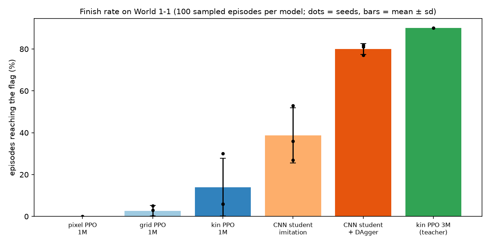
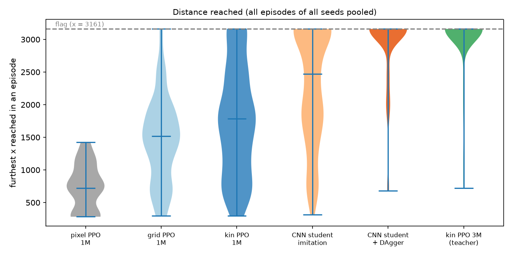
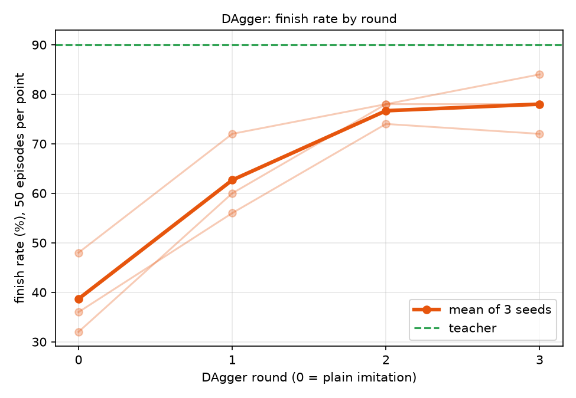
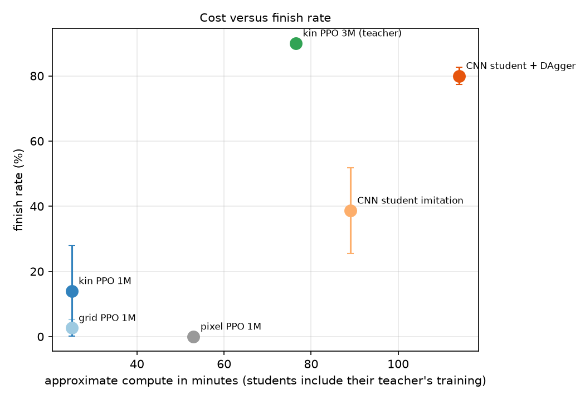
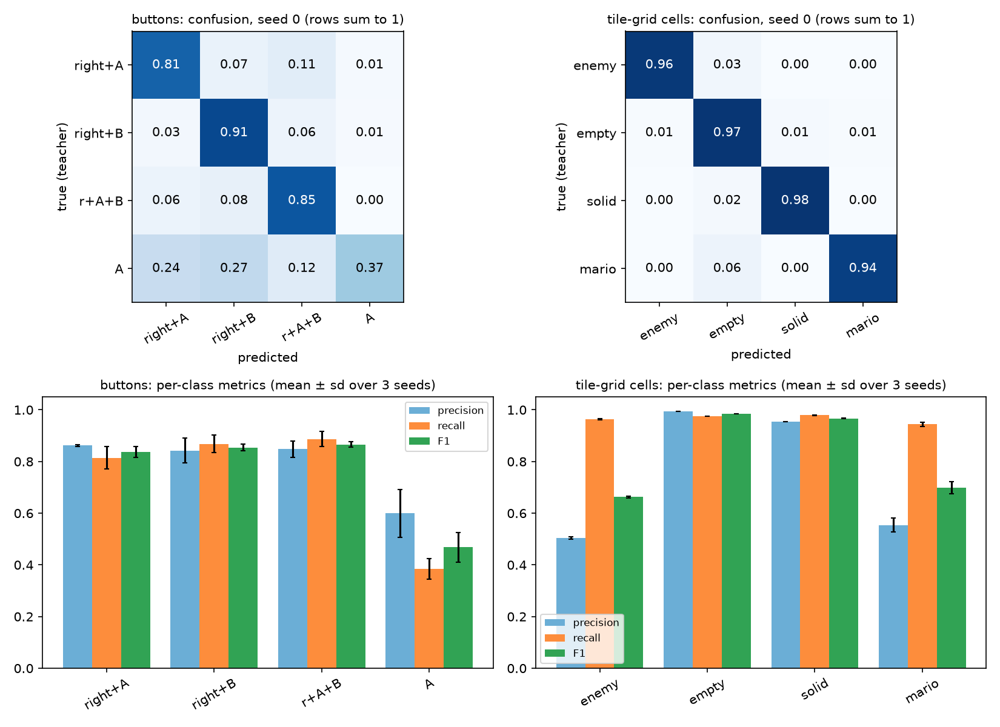
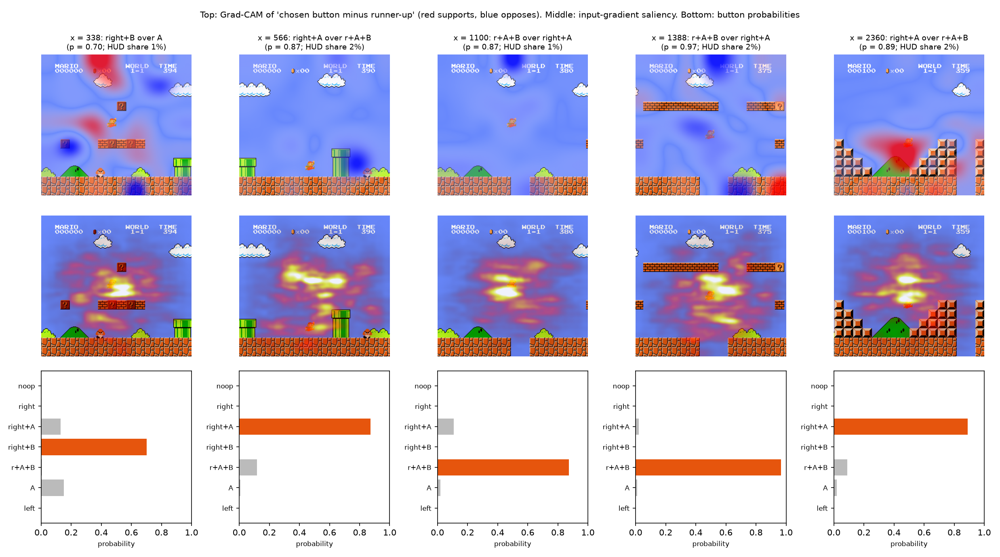
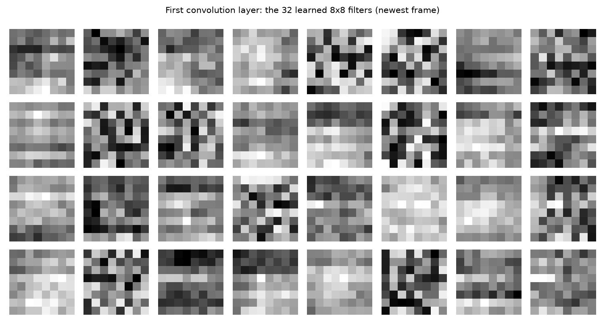

# Learning to Play Super Mario Bros with CNN-Based Reinforcement Learning
# Apprentissage par renforcement avec CNN pour jouer à Super Mario Bros

School project, Deep Learning (5IIR-DDSI), adapted from subject 21: a CNN turns screen frames
(instead of camera gestures) into game commands. Everything is on World 1-1 of Super Mario Bros,
trained and evaluated on an 8 GB MacBook (Apple M1).

**Question:** can a CNN learn to play Mario from pixels alone on a small laptop?

**Answer in short:**
- Reinforcement learning (PPO) on pixels from scratch: no. 0 of 100 episodes finish the level after 1M steps.
- PPO on the game's own memory (a tile map plus position and speed): yes. With 3M steps it finishes 90 of 100.
- A CNN that sees only pixels, trained to imitate that agent and corrected with DAgger: it finishes
  **80.0 +/- 2.6 %** of episodes (3 seeds), about 0.37 ms per decision on a CPU.

## Results

100 sampled episodes per model, one evaluation script for every row (evaluation/eval_final.py).
Finish rate = share of episodes that reach the flag (x = 3161). "+/-" is the spread across seeds.

| model | what it sees | seeds | finish rate | mean max x | latency (CPU) |
|---|---|---|---|---|---|
| random / scripted baselines | - | - | 0% | 570 / 695 | - |
| pixel PPO, 1M steps | 4 gray frames | 1 | 0.0% | 739 | 0.50 ms |
| grid PPO, 1M steps | tile map from game memory | 3 | 2.7 +/- 2.5% | 1455 +/- 204 | 0.12 ms |
| kin PPO, 1M steps | tile map + exact position and speed | 3 | 14.0 +/- 13.9% | 1747 +/- 386 | 0.12 ms |
| kin PPO, 3M steps (the teacher) | tile map + position and speed | 1 | 90.0% | 3012 | 0.11 ms |
| CNN student, plain imitation | 4 gray frames | 3 | 38.7 +/- 13.2% | 2282 +/- 234 | 0.37 ms |
| **CNN student + DAgger** | **4 gray frames** | 3 | **80.0 +/- 2.6%** | **2906 +/- 34** | **0.37 ms** |

DAgger roughly doubles the finish rate and makes the seeds much more consistent:

Compute (approximate; the students include the 3M-step teacher):

## Method

- **Environment** (mario_env.py): gym-super-mario-bros through a wrapper. Each decision lasts 4 frames
  (frame skip), the last 4 observations are stacked, no rendering during training. Reward per decision =
  pixels moved right - 0.1, -15 on death, +50 at the flag; episodes are cut after 250 decisions without
  progress.
- **Three views of the game:** pix (4 gray 84x84 frames), grid (13x11 tile map read from the game memory),
  kin (grid + exact position inside the tile + x and y speed). Same PPO settings for all three.
- **Teacher:** PPO on the kin view, 3M steps (about 76 minutes).
- **Student** (student.py): the default pixel CNN (3 convolution layers + a 512-unit layer) with two heads: the
  button (trained on the teacher's probabilities) and an auxiliary task predicting the tile map.
- **DAgger** (train/dagger.py): the student plays, the teacher labels every state the student reaches, the
  data is aggregated and the student retrained. 3 rounds of 40,000 states.
- **Important:** the teacher reads the game's memory (privileged information). At play time the student
  uses pixels only.

## What the student does with its input

- Per-class precision, recall and F1 and the confusion matrices (held-out episodes, plain-imitation students):

- Grad-CAM and input-gradient saliency (coarse: the last convolution layer is 7x7), and the learned first-layer filters:

- **HUD test:** blanking the score/coins/timer rows changed the finish rate of the three DAgger students by
  +4, -4 and -5 points (80.0% to 78.3% on average), within the noise of 100 episodes, and the HUD rows get
  1.9% of the input-gradient saliency (they cover 13.1% of the image rows). No evidence that the CNN uses the HUD.

Demo videos (the game on the left, the CNN's button probabilities on the right) are in docs/.

## Limitations

- One level (World 1-1) in a deterministic emulator. No claim about other levels; the student may use
  scenery as a location cue (only the HUD was tested).
- One teacher; the 3 student seeds vary the student only. The pixel PPO baseline is 1 seed, 1M steps, and its
  settings were not tuned; a pixel PPO with a larger budget was not tried.
- The student keeps about 89% of the teacher's finish rate (80.0% vs 90%); the remaining gap is real but small.
- Evaluation samples actions from each model (the emulator is deterministic, so greedy play would repeat one
  episode). With 100 episodes a single model's finish rate has about +/- 4 points of noise.
- Compute figures are partly estimated from timings.

## Setup

    python3.13 -m venv .venv
    source .venv/bin/activate
    pip install -r requirements.txt

## Reproduce (run from the repository root)

    python -m checks.smoke_test
    python -m checks.baselines
    python -m train.train_mlp 2 3000000 kin            # teacher: seed 2, 3M steps, variant grid | kin | pix
    python -m train.collect 100000 models/kin_seed2_3000k data/kin3m_100k.npz
    python -m train.train_student data/kin3m_100k.npz student_v1 15 1.0 0
    python -m train.dagger data/kin3m_100k.npz models/kin_seed2_3000k models/student_v1.pt dagger_v1 3 40000 8 0
    python -m evaluation.eval_final 100                # all models, one protocol
    python -m analysis.make_figures
    python -m analysis.gradcam models/dagger_v1_r3.pt
    python -m evaluation.play_video models/dagger_v1_r3.pt greedy docs/demo.mp4

## Repository layout

- mario_env.py, mario_grid_env.py, mario_kin_env.py, student.py: shared code (environments and the CNN)
- train/: PPO training, data collection, student training, DAgger
- evaluation/: evaluation of all models, in-game play, demo video, HUD test
- analysis/: learning curves, death positions, figures, Grad-CAM
- checks/: sanity checks and benchmarks (smoke test, baselines, CPU vs GPU, gradient-descent toy)
- results/: per-episode evaluation data and logs; runs/: training logs; docs/: figures and videos
- models/: final PPO models and the three DAgger students (data/ is regenerated, not stored)
